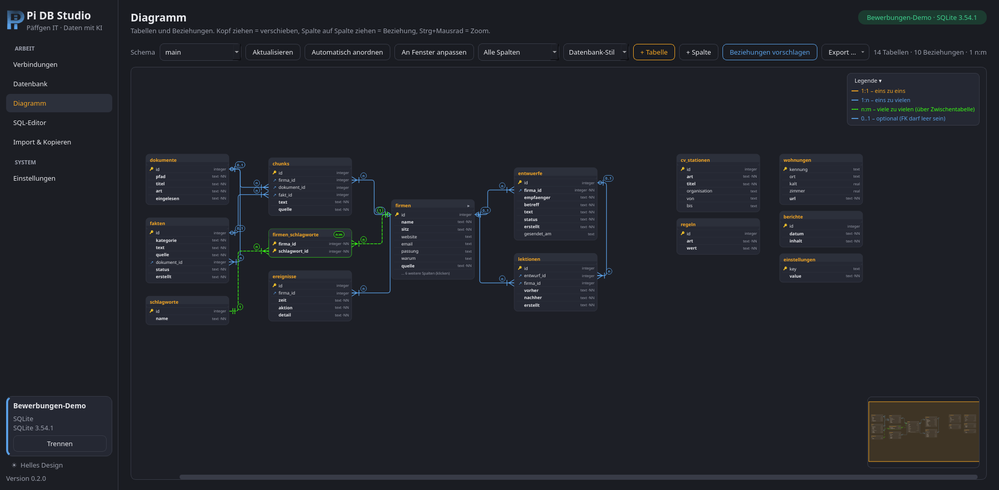

# Pi DB Studio

Schlankes Datenbank-Werkzeug mit KI-Assistent – im Look von Job Agent und Päffgen-IT-Dashboard
(dunkel/hell, Orange/Blau). Desktop in Python/PySide6, eine Web-Oberfläche folgt später.




## Was drin ist (0.1.0)

| Bereich | Umfang |
|---|---|
| Datenbanken | PostgreSQL (psycopg 3), MySQL/MariaDB (PyMySQL), SQLite, DuckDB, SQL Server (pymssql) |
| Verbindungen | Karten mit Farbmarkierung (rot = produktiv …), Schreibschutz je Verbindung, TLS (`sslmode`), Test-Knopf. Einstellungen in `~/.config/db-studio/verbindungen.json` (600), **Passwörter nur im Schlüsselbund** (Dienst `db-studio`) |
| Objektbaum | Schemas → Tabellen, Views, Indizes, Funktionen; Suche; Kontextmenü (Öffnen, SELECT im Editor, kopieren) |
| Datenraster | Seiten, Sortieren per Spaltenkopf, Filter (WHERE), Zellen bearbeiten, Zeilen hinzufügen/löschen – gesammelt, dann **Übernehmen** in einer Transaktion oder **Verwerfen**. Nur mit Primärschlüssel und ohne Schreibschutz |
| SQL-Editor | Tabs, Hervorhebung, Autovervollständigung (Schlüsselwörter, Tabellen, `tabelle.` → Spalten), Strg+Enter (Markierung oder alles), mehrere Anweisungen, EXPLAIN, Abbrechen, Verlauf, Ergebnis nachladen statt alles auf einmal. Läuft im Hintergrund – die Oberfläche friert nicht ein |
| Diagramm | ER-Diagramm mit Krähenfuß-Notation (1:n, 1:1, n:m), Zoom, automatische Anordnung; Tabellen, Spalten und Beziehungen per Ziehen anlegen – immer erst als DDL-Vorschau im passenden Dialekt, dann in einer Transaktion; „Beziehungen vorschlagen“ (Namensregel + KI, nur Schema); Export PNG/SVG |
| Import/Export | Export CSV, JSON, Excel, SQL-INSERT (Tabelle oder Ergebnis). Import aus CSV/JSON/JSON Lines/Excel mit Vorschau, Spaltenzuordnung, neuer Tabelle (Typen aus den Daten) – alles oder nichts |
| Tabelle kopieren | Zwischen beliebigen Verbindungen, Typen werden abgebildet (z. B. SQLite → PostgreSQL), Stapel in einer Transaktion |
| KI-Assistent | Text → SQL, Abfrage erklären, optimieren (mit EXPLAIN-Plan), Fehler erklären. Anbieter: Claude-API (Schlüssel im Schlüsselbund, Standard `claude-opus-5-5`), Claude Code (Abo) oder lokal per Ollama |
| Schutz | Rückfrage bei UPDATE/DELETE ohne WHERE, DROP, TRUNCATE, ALTER … DROP; ändernde Anweisungen aus der KI und auf „produktiv“ markierten Verbindungen nur nach Bestätigung; Schreibschutz sperrt alles Ändernde |

**Datenschutz bei der KI:** Standardmäßig geht nur das Schema (Tabellen, Spalten, Typen) an das Modell, keine Datenzeilen.
Der Schalter „Beispielzeilen mitsenden“ ist aus. KI-SQL wird nie automatisch ausgeführt, sondern in einen neuen Tab übernommen.

## Starten

```bash
cd ~/Dev/db-studio
python3 -m venv venv && venv/bin/pip install -r requirements.txt
venv/bin/python -m dbstudio
```

## Web-Oberfläche (0.3.0)

```
venv/bin/pip install -r requirements-web.txt
DBSTUDIO_SCHLUESSEL=$(venv/bin/python -m dbstudio.web schluessel) DBSTUDIO_WEB_DATEN=/tmp/dbweb \
  sh -c 'echo "ein-langes-passwort" | venv/bin/python -m dbstudio.web benutzer admin; DBSTUDIO_PORT=8443 venv/bin/python -m dbstudio.web'
```

Betrieb im Heimnetz: `deploy/deploy-web.sh` → https://192.168.178.215 (Container 104). Admin-Passwort liegt im
Schlüsselbund (Dienst `db-studio`, Eintrag `web:admin@192.168.178.215`).

## Tests

```bash
venv/bin/python -m pytest -q                          # SQLite, DuckDB, Oberfläche (offscreen)
venv/bin/python tests/pg_testdb_anlegen.py            # einmalig: Postgres-Test-DB, Passwort nur im Schlüsselbund
```

Postgres-Tests laufen gegen `dbstudio_test` (Host per `DBSTUDIO_TEST_PG_HOST`) und werden übersprungen, wenn die
Datenbank nicht erreichbar ist. MySQL/MariaDB- und SQL-Server-Tests laufen gegen `dbstudio_test` auf CT 105
(`DBSTUDIO_TEST_MY_HOST` / `DBSTUDIO_TEST_MS_HOST`, Standard 192.168.178.216, Benutzer `dbstudio`); Passwörter kommen
aus `DBSTUDIO_TEST_MY_PASSWORT` / `DBSTUDIO_TEST_MS_PASSWORT` oder dem Schlüsselbund (`db-studio`,
`mysql:dbstudio@<host>` bzw. `mssql:dbstudio@<host>`), sonst werden sie übersprungen.

## Screenshots

`QT_QPA_PLATFORM=offscreen venv/bin/python docs/screenshots.py` baut eine Demo-Datenbank mit erfundenen Daten und
speichert `docs/verbindungen.png`, `docs/datenbank.png`, `docs/sql-editor.png`.
