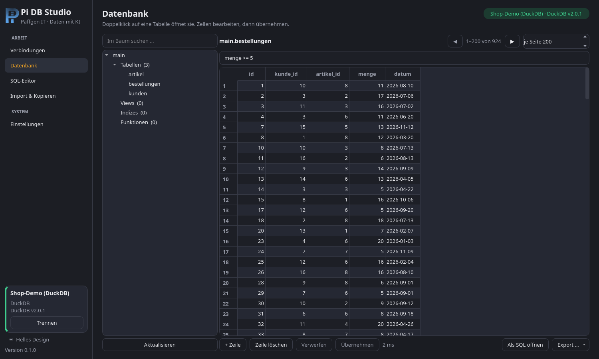
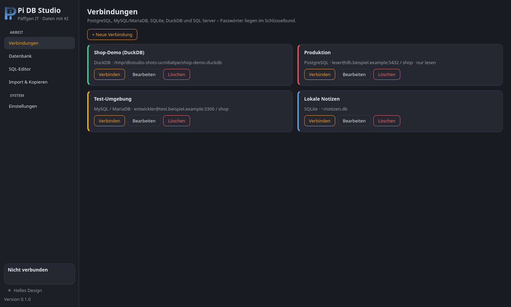
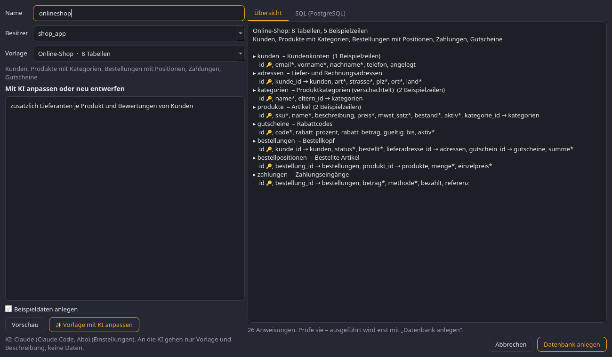
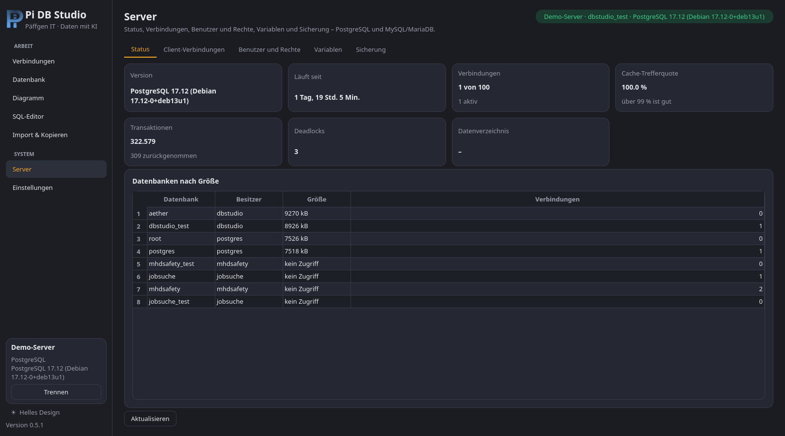
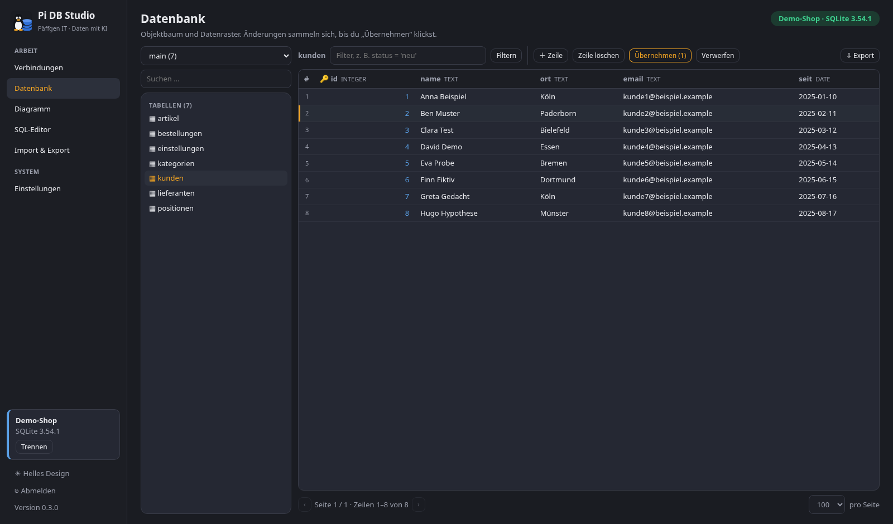

<div align="center">


# Pi DB Studio

**Ein Datenbank-Studio für alles zwischen der einen Tabelle und dem ganzen Server – mit KI, die fragt, bevor sie etwas tut.**

PostgreSQL · MySQL/MariaDB · SQL Server · SQLite · DuckDB · Microsoft Access (Import)

[](https://github.com/peter1965p/pi-db-studio/releases/latest)


[](LICENSE)



[**Herunterladen**](#installation) · [Funktionen](#was-pi-db-studio-kann) · [KI](#ki--deine-wahl-dein-schema-deine-daten) · [Sicherheit](#sicherheit) · [Aus dem Quellcode](#aus-dem-quellcode) · [Web-Oberfläche](#web-oberfläche-und-rest-api)

</div>

---

## Installation

<div align="center">

[](https://github.com/peter1965p/pi-db-studio/releases/latest/download/PiDBStudio-Windows-Setup.exe)
[](https://github.com/peter1965p/pi-db-studio/releases/latest/download/PiDBStudio-Linux-x86_64.AppImage)

</div>

Python muss nicht installiert sein. Alle Dateien jeder Version: **[Releases](https://github.com/peter1965p/pi-db-studio/releases)**.

| System | Datei | So geht's |
|---|---|---|
| **Windows 10/11** | [`PiDBStudio-Windows-Setup.exe`](https://github.com/peter1965p/pi-db-studio/releases/latest/download/PiDBStudio-Windows-Setup.exe) | Installer mit Startmenü-Eintrag, auf Wunsch ohne Admin-Rechte |
| Windows portabel | [`PiDBStudio-Windows-x64-portabel.zip`](https://github.com/peter1965p/pi-db-studio/releases/latest/download/PiDBStudio-Windows-x64-portabel.zip) | entpacken, `PiDBStudio.exe` starten – z. B. vom USB-Stick |
| **Linux** (Ubuntu, Debian, Fedora, Arch, openSUSE, Mint …) | [`PiDBStudio-Linux-x86_64.AppImage`](https://github.com/peter1965p/pi-db-studio/releases/latest/download/PiDBStudio-Linux-x86_64.AppImage) | `chmod +x PiDBStudio-*.AppImage && ./PiDBStudio-*.AppImage` |
| Linux zum Entpacken | [`PiDBStudio-Linux-x86_64.tar.gz`](https://github.com/peter1965p/pi-db-studio/releases/latest/download/PiDBStudio-Linux-x86_64.tar.gz) | entpacken, `PiDBStudio/PiDBStudio` starten |

Prüfsummen liegen als `SHA256SUMS-*.txt` daneben. Jedes Paket wird beim Bauen automatisch mit einem Selbsttest gestartet (Treiber, Oberfläche, Vorlagen) – erst dann kommt es ins Release.

> **Windows meldet „Der Computer wurde durch Windows geschützt“?** Das Programm ist (noch) nicht signiert. „Weitere Informationen“ → „Trotzdem ausführen“.

> **AppImage startet nicht?** Auf manchen Systemen fehlt `libfuse2` (Ubuntu 22.04+: `sudo apt install libfuse2`) – oder einfach das tar.gz nehmen.

---

## Was Pi DB Studio kann

### Verbindungen, Baum und Daten



- **Fünf Datenbanken in einer Oberfläche**, Verbindungen als Karten mit Farbmarkierung (rot = produktiv), Schreibschutz je Verbindung, TLS
- **Serverbaum:** Mit einem PostgreSQL-Server verbunden, siehst du **alle Datenbanken** auf einmal – aufklappbar bis zur Tabelle. Neue Datenbank anlegen, umbenennen, löschen (mit Folgen-Analyse: Größe, Tabellen, offene Verbindungen)
- **Datenraster** mit Seiten, Sortierung, Filter, Bearbeiten direkt in der Zelle – gesammelt und in **einer** Transaktion übernommen
- **Passwörter nur im Schlüsselbund** des Systems, nie in einer Datei; gleiche Anmeldung für mehrere Datenbanken wird wiederverwendet

### SQL-Editor


Tabs, Hervorhebung, Autovervollständigung (`tabelle.` → Spalten), Strg+Enter, mehrere Anweisungen, EXPLAIN, Abbrechen, Verlauf. Läuft im Hintergrund – die Oberfläche friert nie ein. Schutzabfrage bei `UPDATE`/`DELETE` ohne `WHERE`, `DROP`, `TRUNCATE`.

### ER-Diagramm mit Folgen-Analyse


Krähenfuß-Notation, Zoom, automatische Anordnung, Stil wie EF Core. Tabellen, Spalten und Beziehungen **per Ziehen** anlegen – immer erst als DDL-Vorschau im passenden Dialekt. Vor jeder Schlüssel- oder Beziehungsänderung zeigt Pi DB Studio, **welche Datensätze ihren Bezugspunkt verlieren würden** – auch bei Beziehungen ohne Constraint. „Beziehungen vorschlagen“ findet fehlende Fremdschlüssel per Namensregel und KI.

### Neue Datenbanken aus Vorlagen – oder aus deinen Worten



- **Acht Vorlagen:** Online-Shop, CRM, Blog/CMS, Lager & Warenwirtschaft, Ticketsystem, Vereinsverwaltung, Personal & Zeiterfassung, Projekte & Aufgaben
- **KI-Entwurf:** Beschreib, was die Datenbank können soll – „Fahrradverleih mit Kunden, Rädern, Buchungen und Wartung“ – und bekomm ein normalisiertes Schema mit Beziehungen und Beispieldaten. Oder lass eine Vorlage anpassen („zusätzlich Lieferanten und Bewertungen“)
- Alles, was die KI liefert, wird **geprüft und bereinigt** (Namen, Typen, Verweise, Zyklen). Du siehst Tabellen, Beziehungen und **jede Zeile SQL** – änderbar – bevor irgendetwas angelegt wird
- SQL für PostgreSQL, MySQL/MariaDB, SQL Server, SQLite und DuckDB; Tabellen in Abhängigkeitsreihenfolge, Indizes auf Fremdschlüssel
- Im Serverbaum unter **„＋ Datenbank“**, in jeder bestehenden Datenbank per Rechtsklick auf ein Schema → **„Vorlage einspielen“**

### Server-Verwaltung



Angelehnt an die Administration der MySQL Workbench, für PostgreSQL und MySQL/MariaDB:

| Bereich | Was du siehst und tun kannst |
|---|---|
| **Status** | Version, Laufzeit, Verbindungen, Cache-Trefferquote, Transaktionen, Datenbanken nach Größe |
| **Client-Verbindungen** | Wer mit welcher Abfrage verbunden ist (alle 5 s aktuell) – Abfrage abbrechen, Verbindung trennen |
| **Benutzer und Rechte** | Rollen anlegen und bearbeiten, Passwort setzen, Zugriff je Datenbank, Löschen mit Folgen (Besitz, Verbindungen) |
| **Variablen** | Alle Servereinstellungen mit Suche, „nur geänderte“, Hinweis auf nötigen Neustart |
| **Sicherung** | SQL-Dump einer Datenbank per pg_dump bzw. mysqldump |

### Import, Export, Kopieren

- Export als CSV, JSON, Excel, SQL-INSERT; Import aus CSV, JSON, JSON Lines, Excel mit Vorschau und Spaltenzuordnung
- **Microsoft Access** (.mdb, .accdb) übernehmen – ohne Access und ohne Windows, mit echten Typen und Schlüsseln. Die Demo legt **Northwind** komplett an (8 Tabellen, 3.202 Zeilen, 9 klassische Abfragen als Views)
- **SQL-Dumps** (z. B. Supabase-Schema-Export) lauffähig machen und in einer Transaktion einspielen
- Tabellen **zwischen beliebigen Verbindungen kopieren**, Typen werden abgebildet

---

## KI – deine Wahl, dein Schema, deine Daten

Text → SQL, Abfrage erklären, optimieren (mit EXPLAIN-Plan), Fehler erklären, Beziehungen vorschlagen, Datenbanken entwerfen.

Beim ersten Mal fragt Pi DB Studio, **wie** du die KI nutzen willst – es wird nie still entschieden:

| Weg | Was nötig ist |
|---|---|
| **Claude-Abo (Pro oder Max)** | [Claude Code](https://docs.claude.com/en/docs/claude-code/overview) installiert und angemeldet – kein API-Schlüssel |
| **Anthropic-API-Schlüssel** | Schlüssel eingeben, er landet im Schlüsselbund; Abrechnung je Anfrage |
| **Lokal mit Ollama** | Ein Modell in Ollama – dann verlässt nichts den Rechner |

An die KI geht standardmäßig **nur das Schema** (Tabellen, Spalten, Typen) bzw. deine Beschreibung – Datenzeilen nur, wenn du „Beispielzeilen mitsenden“ einschaltest. KI-SQL wird **nie** automatisch ausgeführt.

---

## Sicherheit

- Passwörter ausschließlich im Schlüsselbund des Betriebssystems (Linux Secret Service/KWallet, Windows-Anmeldeinformationen)
- PostgreSQL-Passwörter für Rollen gehen als **SCRAM-SHA-256-Verifier** an den Server – der Klartext erreicht ihn nie, auch nicht sein Log
- Schreibschutz je Verbindung sperrt alles Ändernde, auch in Server-Verwaltung und Vorlagen
- Rückfrage bei gefährlichen Anweisungen und auf „produktiv“ markierten Verbindungen
- Löschen von Datenbanken nur mit eingetipptem Namen; `postgres` und `template*` sind geschützt

---

## Aus dem Quellcode

```bash
git clone https://github.com/peter1965p/pi-db-studio.git
cd pi-db-studio
python3 -m venv venv && venv/bin/pip install -r requirements.txt
venv/bin/python -m dbstudio
```

Unter Windows: `py -m venv venv`, `venv\Scripts\pip install -r requirements.txt`, `venv\Scripts\python -m dbstudio`.

Nützlich: `python -m dbstudio --version`, `--selbsttest` (lädt alles ohne Fenster), `--verbindung '{"art": "sqlite", "datei": "…"}' --tabelle Kunden` (direkt verbinden – so öffnet [Visual Death Studio](https://github.com/peter1965p/visual-death-studio) Datenbanken in Pi DB Studio).

Pakete selbst bauen: `pip install pyinstaller && pyinstaller packaging/pi-db-studio.spec` → `dist/PiDBStudio/`. Die Releases baut `.github/workflows/release.yml` bei jedem Tag `v*` für Linux und Windows.

---

## Web-Oberfläche und REST-API

Dieselben Funktionen im Browser, für den eigenen Server – mit Anmeldung, HTTPS und einer **generischen REST-API mit Rechten**:



```bash
venv/bin/pip install -r requirements-web.txt
DBSTUDIO_SCHLUESSEL=$(venv/bin/python -m dbstudio.web schluessel) DBSTUDIO_WEB_DATEN=/tmp/dbweb \
  sh -c 'echo "ein-langes-passwort" | venv/bin/python -m dbstudio.web benutzer admin; DBSTUDIO_PORT=8443 venv/bin/python -m dbstudio.web'
```

REST: Unter „API & Rechte“ API-Schlüssel anlegen – je Schlüssel Verbindung, Tabelle, Rolle (Leser/Schreiber/Admin), gesperrte Spalten, Zeilenfilter, Rate-Limit; Schlüssel nur als Hash gespeichert.

```bash
curl -H "Authorization: Bearer pi_…" "https://<host>/rest/v1/<verbindung>/kunden?ort=eq.Osnabrück&order=name.asc"
```

Filter `spalte=op.wert` mit `eq, neq, gt, gte, lt, lte, like, is.null`; dazu `select`, `order`, `limit`, `offset`; Einzelzugriff `GET/PATCH/DELETE …/{tabelle}/{pk}`, Anlegen per `POST`. `/rest/v1/openapi.json` zeigt nur, was der Schlüssel darf.

---

## Tests

```bash
QT_QPA_PLATFORM=offscreen venv/bin/python -m pytest -q
```

SQLite, DuckDB und die Oberfläche laufen immer. PostgreSQL-, MySQL/MariaDB- und SQL-Server-Tests laufen gegen eine Test-Datenbank `dbstudio_test` (Hosts per `DBSTUDIO_TEST_PG_HOST`, `DBSTUDIO_TEST_MY_HOST`, `DBSTUDIO_TEST_MS_HOST`, Passwörter per Umgebung oder Schlüsselbund) und werden übersprungen, wenn keine erreichbar ist.

---

## Über das Projekt

Architektur und Konzept: **Peter Päffgen, Päffgen IT** – Datenbankentwicklung seit den Tagen von MS Access. Den Code schreibt die KI nach meinen Vorgaben. So entsteht heute Software.

Die Access-Demo `dbstudio/demo/northwind.mdb` stammt aus den Testdaten des mdbtools-Projekts; Northwind selbst stellt Microsoft in `microsoft/sql-server-samples` unter MIT-Lizenz bereit.

Lizenz: [MIT](LICENSE)
